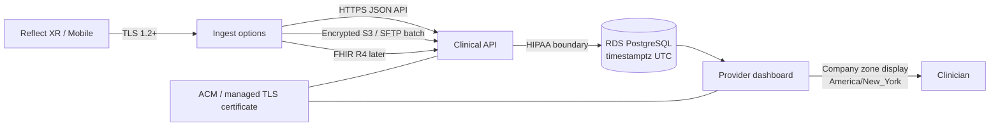
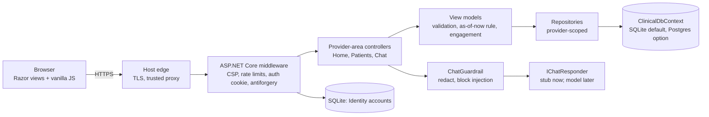

# Architecture — Reflect Provider Dashboard

Give clinicians a longitudinal view of Reflect XR and Reflect Mobile using **synthetic data** in this prototype. Production storage is **Amazon RDS for PostgreSQL** (`timestamptz` in UTC). Display uses the facility time zone.

Clinicians can open **Trust** (`/Provider/Home/Trust`) for the same material.

## Architecture diagram



Product analytics (Firebase → BigQuery) stay **outside** the clinical boundary. Clinical sessions, affect markers, and device history do not go to analytics warehouses.

This prototype implements the dashboard, UTC clock, TLS, assignment-scoped access, and a signed JSON ingest hook. Repositories are in-memory until merge into Reflect XR (EF Core against RDS).

## Time zones (normalized for the company)

| Layer | Rule |
| --- | --- |
| Wire format | ISO-8601 with offset or `Z` (`2026-11-06T16:00:00-05:00`) |
| Application | `DateTimeOffset.ToUniversalTime()` on ingest and seed |
| RDS PostgreSQL | `timestamptz` **always UTC** — never store a local wall clock |
| Display | `Company:TimeZone` IANA id (default `America/New_York` / ET) |
| Comparisons | Needs Attention and emotional trajectory windows run in UTC |

Source details still show the UTC instant so two facilities cannot disagree about “when.” Change the company zone in configuration; do not convert rows in the database.

```sql
-- Production session table (target)
started_at timestamptz NOT NULL, -- UTC
-- Display: AT TIME ZONE is an application concern, not a stored local time
```

## Integration options (future connectivity)

1. **HTTPS JSON ingest (implemented)** — `POST /api/v1/ingest/sessions` with `X-Reflect-Integration-Key`. Timestamps are normalized to UTC before storage. Disabled unless `Integration:Enabled` is true. Development demo key lives only in `appsettings.Development.json`.
2. **Encrypted batch** — nightly CSV/Parquet to a KMS-encrypted S3 bucket or SFTP. Worker upserts UTC rows into RDS when devices cannot call the API live.
3. **EHR / FHIR R4** — Encounter and Observation over mutually authenticated TLS. Map MRN to `externalPatientId`. Same UTC rule.
4. **Private connectivity** — VPC peering or PrivateLink from Reflect XR into the clinical API. **No public RDS ports.**

## HIPAA check

**This prototype is not a HIPAA-covered production system.** Seed records are fictional. The **production target** is HIPAA-aligned:

| Safeguard | Production target | Prototype today |
| --- | --- | --- |
| BAA | Cloud BAA (e.g. AWS RDS) | Not applicable (no PHI) |
| Unique user ID / auth | Facility IdP (Entra) + MFA | Identity + hashed passwords + lockout |
| Automatic logoff | Idle timeout | 1-hour absolute cookie |
| Encryption in transit | TLS 1.2+ everywhere | HTTPS redirection; HSTS in Production |
| Encryption at rest | RDS encryption + KMS | Local SQLite accounts, mode 600 on Unix |
| Audit controls | Immutable access log for ePHI | HTTP logs; clinical audit table still TODO |
| Minimum necessary | Assigned caseload only | Provider assignment enforced in repositories |
| Integrity | Hashes, signed ingest, UTC | Identity hashes, antiforgery, ingest key |
| Transmission | No PHI in query strings / analytics | CSP, no-store, Referrer-Policy |

Workforce training, facility policies, and the organizational risk analysis remain with the covered entity.

## Security — CIA

- **Confidentiality** — TLS certificate, role-based sign-in, assignment-scoped patients/sessions/devices, CSP, `Cache-Control: no-store`, HttpOnly cookies.
- **Integrity** — password hashes, antiforgery on browser posts, fixed-time compare on the ingest key, UTC timestamps so local clocks cannot reorder sessions.
- **Availability** — rate limits on account and ingest, `/health/live`, HSTS in Production.

## Secure certificate

- **Local:** ASP.NET Core HTTPS development certificate (`https://localhost:7150`).
- **Hosted demo:** platform managed cert (Render / Azure) with `Hosting:HttpsAtEdge`.
- **Production:** AWS Certificate Manager on the load balancer, or Azure App Service managed TLS 1.2+, HTTP redirected to HTTPS, HSTS ≥ 1 year.

## Request flow (this prototype)



Patient and session data now live in a database (`ClinicalDbContext`), seeded with synthetic rows. Target: feed it by file upload (XLS/CSV), then database or API sources, behind the same repository interfaces. The Clinical API / HIPAA boundary in the layering diagram above is where real PHI would enter.

## Security notes (prototype)

- Development-only account creation and opt-in hosted synthetic demo sign-in use ASP.NET Core Identity with SQLite under `App_Data/`.
- Registration assigns the provider role and does not verify credentials. Replace with the facility identity provider before production.
- No real PHI — seed data is fictional.

## Extension merge checklist

1. Copy `Areas/Provider/**` into Reflect XR web project.
2. Register `ProviderOnly` policy against real Entra roles.
3. Replace in-memory repositories with EF Core + RDS PostgreSQL (`timestamptz`).
4. Drop `wwwroot/standins/` layout; views use production `_Layout.cshtml`.
5. Append `provider-menu.json` items to the facility/provider sidebar config.
6. Point ingest at the clinical API and rotate `Integration:ApiKey` into a secret store.

## Patient browsing (prototype)

`IPatientRepository.SearchAsync` filters non-deleted synthetic patients by name,
external ID, and engagement signal, then applies stable name/ID ordering and
bounded pagination. The patient list loads session summaries only for patients
on the requested page. The dashboard still uses full-population reads. This is
an in-memory implementation with provider assignment checks on patient/session access, not tenant-scoped clinical data access; production
authorization, database-side aggregation, and audit work remain in TODO.md.
